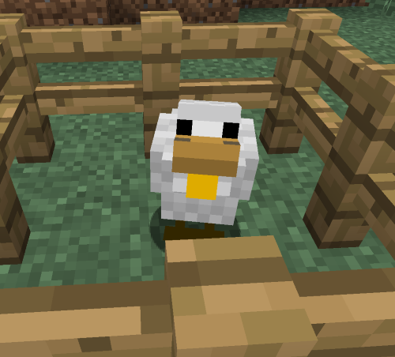

# Golden Egg

## Description

---

Golden Eggs can be found inside of Bean Pods, grown from [Magic Beans](beans). When thrown, a Chicken with a Golden Wattle will hatch. Drop gold ore next to the Golden Chicken and it will pick the ore up, chew it (with eating particles), and drop 3 gold ingots. It follows players holding a valid input item. Alongside that, it can also be configured to lay golden ingots instead of eggs.

### CraftTweaker

Golden Chicken conversion recipes can be changed with CraftTweaker. The default recipe is `oreGold` -> 3 gold ingots, taking 30-60 seconds to chew.

```zenscript
import mods.randomthings.GoldenChicken;

// Replace the default gold ore recipe with native gold clusters -> 8 ingots, chewed in 5 seconds
GoldenChicken.removeAll();
GoldenChicken.addRecipe(<ore:clusterGold>, <minecraft:gold_ingot> * 8, 100, 100);

// Add another recipe, using the default 30-60 second chew time
GoldenChicken.addRecipe(<minecraft:gold_nugget> * 1, <minecraft:gold_ingot>);

// Fixed chew time (in ticks)
GoldenChicken.addRecipe(<ore:oreGold>, <minecraft:gold_ingot> * 3, 400);

// Remove recipes whose input matches
GoldenChicken.removeRecipe(<ore:oreGold>);
```

`addRecipe` arguments: input, output, optional min digest ticks, optional max digest ticks. If only one time is given, min and max are the same. Output count comes from the stack size.

## Screenshots

---


